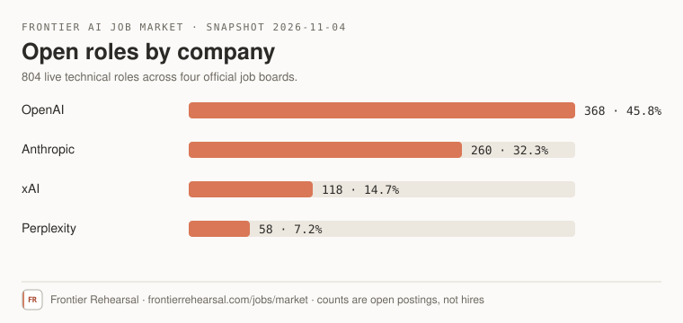
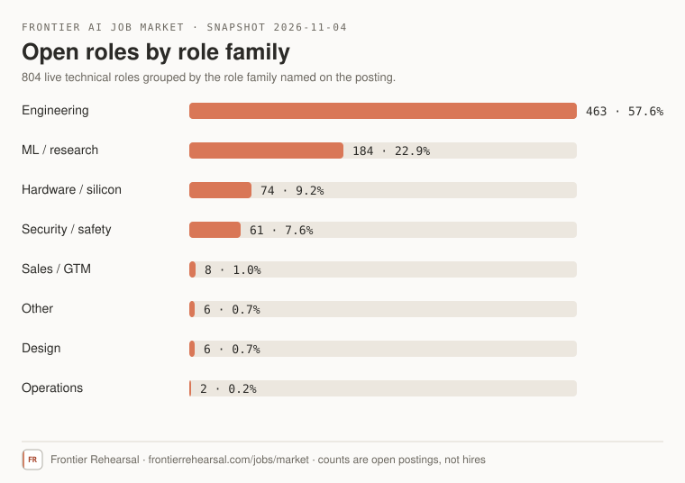

# Frontier AI job market — snapshot 2026-11-04

A frozen copy of the market snapshot published at **[frontierrehearsal.com/jobs/market](https://frontierrehearsal.com/jobs/market)**.

**804 live technical roles** across **OpenAI (368)**, **Anthropic (260)**, **xAI (118)** and **Perplexity (58)**, counted from the companies' official job boards on 2026-11-04. The live page is regenerated from those boards, so its totals move; this repository keeps the 2026-11-04 reading citable.

## What is here

| Path | Contents |
|---|---|
| [`report.md`](report.md) | The stored report markdown, verbatim |
| [`data/snapshot.json`](data/snapshot.json) | `as_of`, total roles, and the company, role-family, level and publication-quarter counts |
| [`charts/roles-by-company.svg`](charts/roles-by-company.svg) | Company chart |
| [`charts/roles-by-family.svg`](charts/roles-by-family.svg) | Role-family chart |

## What the numbers mean

- Counts are **open technical postings**, not hires, applications or headcount.
- Each posting is counted once, after de-duplication across the tracked boards.
- Company totals sum to the 804 headline: 368 + 260 + 118 + 58.
- Role families in the second chart are the family named on the posting, so Engineering (463) and ML / research (184) lead, while Design (6) and Operations (2) are small.
- A keyword or title census measures what a posting names, not the depth a role requires.

## Provenance

Counts are derived from public postings on the companies' official job boards and were assembled by [Frontier Rehearsal](https://frontierrehearsal.com). The written analysis is Frontier Rehearsal's; cite it with a link to the live page. Snapshot retrieved 2026-11-09.
